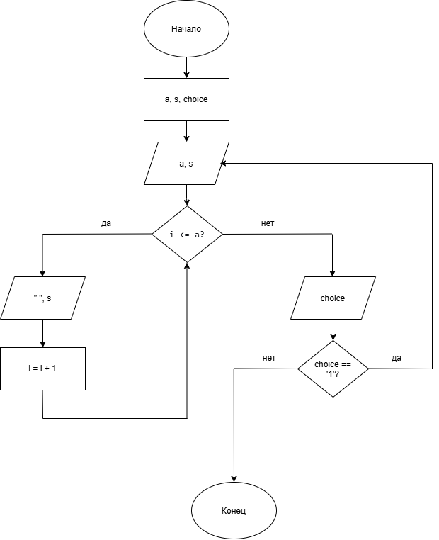

# Домашнее задание к работе 9
## Условие задачи
Напишите программу, выводящую на экран заданную в ДЗ лаб.6 геометрическую фигуру, нарисованную с помощью заданного с клавиатуры символа.
Предусмотреть возможность изменения размеров фигуры путем задания ее размеров в количестве символов пользователем.
## 1. Алгоритм и блок-схема
### Алгоритм решения
1. Начало
2. Объявить переменные:
   - сторона треугольника: a
   - символ рисования: s
   - выбор пользователя для повтора: choice
3. Ввести значение переменной:
   - ввод значения a
   - ввод значения s
4. Отрисовка треугольника:
   - Внешний цикл по строкам от 1 до a
   - Внутренний цикл вывода пробелов (сдвиг вправо)
   - Внутренний цикл вывода символов (с проверкой условий для пустого внутри треугольника)
5. Вывести запрос на продолжение и ввести choice
6. Если choice == '1', вернуться к шагу 3
7. Конец
### Блок-схема

## 2. Реализация программы
```
#define _CRT_SECURE_NO_WARNINGS
#include <stdio.h>
#include <locale.h>

int main()
{
    setlocale(LC_ALL, "RUS");
    int a;
    char s;
    char choice;

    do
    {
        printf("-------------------------------------------------------------\n");
        printf("Введите сторону треугольника: ");
        scanf("%d", &a);
        printf("Введите символ: ");
        scanf(" %c", &s);
        printf("-------------------------------------------------------------\n");

        for (int i = 1; i <= a; i++)
        {
            for (int j = 0; j < i - 1; j++)
                printf(" ");
            for (int j = 1; j <= 2 * (a - i + 1) - 1; j++)
            {
                if (i == 1 || j == 1 || j == 2 * (a - i + 1) - 1)
                    printf("%c", s);
                else
                    printf(" ");
            }
            printf("\n");
        }
        printf("-------------------------------------------------------------\n");
        printf("Хотите нарисовать еще один треугольник? (1 - да, 0 - нет): ");
        scanf(" %c", &choice);
    } while (choice == '1');

    printf("Программа завершена.\n");
    return 0;
}
```
## 3. Результат работы программы
```
-------------------------------------------------------------
Введите сторону треугольника: 3
Введите символ: #
-------------------------------------------------------------
#####
 # #
  #
-------------------------------------------------------------
Хотите нарисовать еще один треугольник? (1 - да, 0 - нет): 1
-------------------------------------------------------------
Введите сторону треугольника: 6
Введите символ: %
-------------------------------------------------------------
%%%%%%%%%%%
 %       %
  %     %
   %   %
    % %
     %
-------------------------------------------------------------
Хотите нарисовать еще один треугольник? (1 - да, 0 - нет): 0
Программа завершена.
```
## 4. Информация о разработчике
**Холодова Елизавета Юрьевна бИЦТ-262**
